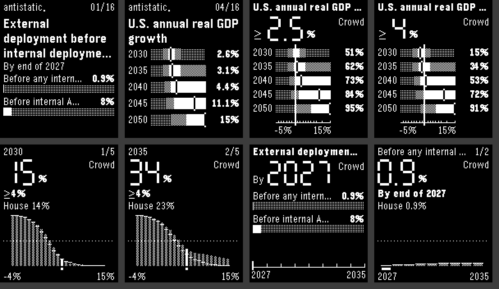
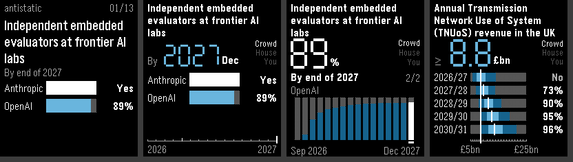
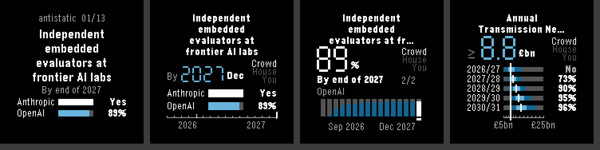

# Antistatic for Pebble

The antistatic.exchange homepage charts on your wrist, drawn like a hi-fi
tuner: segment digits, a red needle, and a status column showing which line
you're reading.





Works on every Pebble: aplite, basalt, chalk, diorite, emery, flint (Pebble 2
Duo) and gabbro (Pebble Round 2). Black-and-white watches get dithered bands
in place of colour. Aplite holds 4 markets; the others hold 24.

## Controls

| Screen | Up / Down | Select | Hold Select |
| --- | --- | --- | --- |
| Markets: one homepage card per page | Previous / next market | Tune in | Account |
| Tuner: the card with a needle | Move the needle along the dates or thresholds (hold to sweep) | Point chart for the first curve | Crowd → house → you |
| Point chart: one curve, bar by bar | Previous / next bar | Next curve (event or year) | Crowd → house → you |

Back steps out. A shake (wrist flick) refreshes from anywhere.

- **Tuner, count markets**: the homepage's ranges (90% dim, middle half
  bright, median tick) with the needle running down through them. The
  readout is the threshold (≥ 2.5%) and each row reads P(value ≥ threshold).
- **Tuner, date markets**: the readout is the date (By 2027 Dec), each row
  is the probability by then, and the needle runs along a dial with a tick
  per bar and a long tick each January.
- **Point chart**: every bar of the curve, the shown line as the bar and the
  other line as a tick across it; the big digits are the selected bar's
  probability, with the other line under it.
- **Status column**: Crowd, House or You lit for the line shown. You appears
  once you're signed in, on markets you've forecast on (bars you haven't
  touched read the house's). The digits turn red on a settled bar, and
  settled curves read Yes or No in the rows.
- A short buzz when the needle takes the first row across 50%.
- The launcher glance shows the first market's headline number.
- Private markets say so in red at the foot of their card.

## Signing in

Hold Select on the market list. The watch shows an eight-digit code: type it
at antistatic.exchange/link on any browser where you're signed in, or open
the app's settings in the phone's Pebble app and tap Sign in, which goes to
that page, inside settings, with the code filled in. Approve, and the watch buzzes twice and
goes back to the list, now with your private markets and your forecasts.

The phone keeps the tokens (read-only, refreshed as they expire); they never
reach the watch. Hold Select on the account screen to sign out.

## Choosing markets

The app's settings in the phone's Pebble app list what the watch shows.
By default that's the homepage's time-sensitive order (open markets with
the most points at stake in the next day first), including your private
markets once you're signed in. Move, remove or add markets and it becomes
your own list, in your order; Time sensitive goes back to the default.

## How it works

The phone side (`src/pkjs/index.js`) reads the API, signed in or not:
`/markets?sort=time` (or each picked market), then
`/markets/:code/forecast?limit=0` (crowd, house and your probability per
bar) and, for date markets, `/markets/:code/submarkets` (the bar dates).
`auth.js` does the device sign-in and token refresh, and `settings.js`
builds the settings page. It works out what the homepage shows (count percentiles
interpolated as `HomeCountBandBuilder` does; date bars at the end of next
year) and sends each market as one small binary message. A market's full
curves go over when you tune into it. The last fetch is cached in the
phone's local storage, and the first three cards on the watch, so the list
appears straight away and then refreshes. The card you're reading has its
curves fetched in the background, so tuning in is instant.

On the watch (`src/c/`): `main.c` receives messages and holds the model,
`draw.c` has the segment readout, bars and formatting, and each screen has
its own file.

## Build and install

Needs the Pebble SDK (`uv tool install pebble-tool`, then
`pebble sdk install latest`).

```bash
pebble build
```

```bash
pebble install --emulator flint
```

On your watch, through the Pebble app's developer connection to CloudPebble:
`pebble login` once, then `pebble install --cloudpebble`. Or open
`build/antistatic-pebble.pbw` on the phone.

`src/pkjs/config.js` sets the site the app talks to; point it at a local
server to try site changes.

`scripts/tour.sh <platform>` clicks through every screen on a running
emulator and saves screenshots to `shots/`; `scripts/sheet.py` tiles them.
